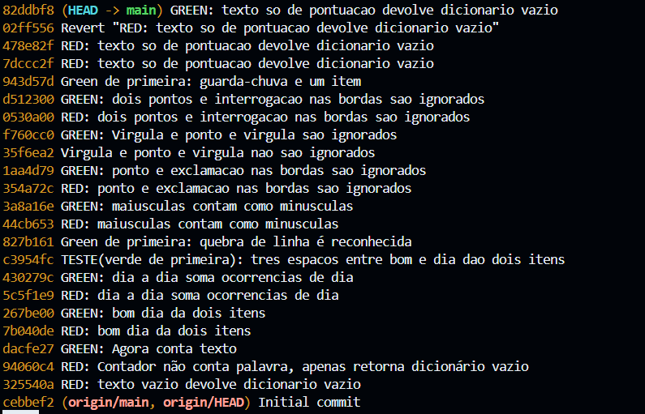
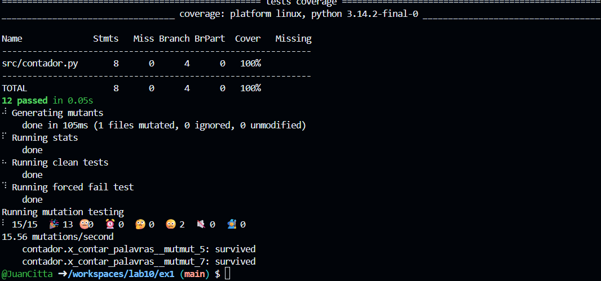

a)
1.""	{} -> caso que não testa nada do conteúdo, apenas devolve o dicionário
2."teste"	{"teste": 1} -> testa o conteúdo apenas com texto
3."bom dia"	dois itens
4."dia a dia"	{"dia": 2, "a": 1}
5."bom   dia" (três espaços)	dois itens
6."bom\ndia"	dois itens
7."Dia dia DIA"	{"dia": 3}
8."fim. Fim!"	{"fim": 2}
9.",dia, ;dia;"	{"dia": 2}
10.":dia: ?dia?"	{"dia": 2}
11."guarda-chuva"	um item
12."... !"	{}

c)
Sim.

d) testes 5, 6 e 11. Os testes anteriores já fizeram o código escrito cobrir a regra testada no teste. Uma recomendação seria manter o teste, por documentação. Porém o teste 5 é redudante e poderia ser removido.

e)
